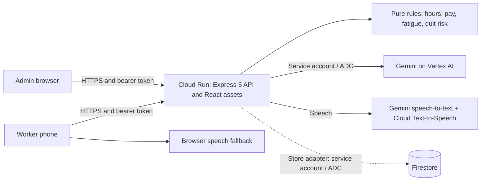

# FairShift architecture

FairShift supports UN SDG 8 through explainable pay, safer shifts, worker feedback and skill records. The deployment target is a React client and a Node.js 22 / Express 5 service on Cloud Run. Core calculations stay in deterministic TypeScript functions; language models explain and classify information rather than calculate wages.

All connections are live in the Cloud Run deployment. `server/index.ts` calls `openStore()`, which loads state from Firestore (seeding it on first start) and saves changes in batches; open dashboards receive changes over Server-Sent Events. The worker app records voice with the phone's microphone; the server transcribes it with Gemini and speaks replies with Cloud Text-to-Speech, falling back to the phone's own voice. Automated tests run with AI off (rule-based fallbacks); the Gemini and Text-to-Speech paths are exercised against the live service.

## Components and data flow

- `server/app.ts` exports `createApp(data, { now })`. Worker and admin routers share one origin, with separate role checks. The app serves compiled React assets when `dist/` exists.
- `server/rules.ts` calculates daily overtime first, then weekly overtime from the remaining regular hours to avoid double counting. PF uses regular pay; ESI uses gross pay. Fatigue flags and quit-risk reasons are explainable signals for a manager to investigate.
- `server/seed.ts` creates deterministic demo organisations, workers, shifts, hazards, feedback and skills relative to a supplied date.
- `server/ai.ts` calls Gemini on Vertex AI using Application Default Credentials. Payslip explanations receive calculated facts. Hazard triage and feedback themes have rule-based fallbacks when AI is disabled or unavailable. New photo, transcription and register helpers also live here; helper availability does not imply an exposed API route.
- `server/speech.ts`: Gemini transcribes voice notes in 16 languages and Cloud Text-to-Speech speaks replies, with the phone's own voice as a fallback. All calls use the Cloud Run service account; no credentials reach the browser.
- `server/store.ts` keeps state in memory for fast reads, saves it to Firestore in debounced batches, and emits change events for live screens. The prototype stores the state as one document and runs as a single Cloud Run instance. To scale: one Firestore document set per organisation (shifts, receipts and hazards as subcollections), transactions for concurrent writes, and Pub/Sub to fan live events out across instances.

The worker checks in using the assigned site's code or nearby GPS coordinates, checks out, and receives calculated hours and pay. An admin sees only their organisation's workers and hazards, can update a hazard's status, and receives feedback averages only above the anonymity threshold.

## Security

Login issues HMAC-SHA256 signed bearer tokens with a 12-hour lifetime. `requireRole` protects worker and admin routers. Hazard updates look up both the report ID and the authenticated organisation, returning 404 for another organisation's report. Worker identity comes from the token rather than a supplied worker ID.

PIN comparison uses constant-time primitives. Login and selected AI routes have per-process rate limits; JSON input has a size limit. Responses set CSP, HSTS, frame restrictions and content-type protections. The browser helper stores tokens in `sessionStorage` and sends them in the Authorization header.

The seed's shared demo PINs and public demo login listing are prototype conveniences. A production rollout should replace them with proper enrolment and hashed credentials, use a stable `SESSION_SECRET` from Secret Manager, enforce HTTPS, restrict service-account permissions and provide rate limiting shared across instances. Vertex AI, Firestore and Text-to-Speech all use the service account (ADC); there are no API keys. Model output is advisory, while payroll remains deterministic.

## Privacy and anonymity

Choosing anonymous hazard reporting omits `reporterId` from storage. The admin overview labels the report **Anonymous** and does not expose a reporter ID. Named reports remain attributable inside the organisation. A worker's own-report list uses reporter identity, so an anonymous report does not appear there.

Feedback stores no worker ID and records only the calendar day, not an exact submission time. The overview implements a **k-anonymity threshold of 3 entries per organisation and topic**: counts remain visible, but `avg` is `null` at zero, one or two entries; an average appears at three. This is an entry-count threshold, not proof of three distinct workers, since anonymous submissions are not deduplicated by identity. The feedback-themes endpoint currently gates on three entries across the organisation, rather than per topic, and deserves a separate privacy review before production use.

Free text can identify someone even when identifiers are omitted. The interface should encourage workers to avoid names and personal details. Deployment policy should define retention, deletion, access logging and provider data handling. GPS currently validates distance at check-in; shift records store the method and site, not raw coordinates. No continuous location tracking is needed.

## Accessibility

Current interface dictionaries cover English, Hindi, Tamil, Telugu and Kannada, using short action labels. Browser dictation and read-aloud helpers support people who prefer speech or find reading difficult. Server language and speech adapters cover additional languages; interface translations must be kept in step before claiming full language coverage.

Typing and manual site-code entry must remain usable when microphone, camera, location or speech services are unavailable. UI acceptance checks should include keyboard access, visible focus, labelled controls, screen-reader announcements, adequate contrast, large touch targets and text equivalents for status colours. The automated tests here validate rules and API behaviour; they do not establish browser accessibility compliance.

## Cross-industry use

| Sector       | Worker needs                                                                 | Employer actions                                           |
| ------------ | ---------------------------------------------------------------------------- | ---------------------------------------------------------- |
| Construction | Clear overtime, fall and electrical hazard reports, training records         | Address unsafe equipment, excessive hours and missing rest |
| Hospital     | Night-shift rest, PPE availability, understandable pay                       | Investigate rapid shift turnarounds and supply shortages   |
| College      | Attendance and pay for housekeeping, security, canteen and maintenance staff | Adjust busy-period staffing and respond to campus hazards  |

Organisations share the same worker/site/shift/hazard model but supply their own policies. Demo construction uses a nine-hour daily threshold; hospital and college use eight. Policy defaults illustrate the prototype and need employer-specific review before payroll use. Quit-risk levels should prompt supportive conversations about workload, safety and pay.

## Verification

`test/rules.test.ts` checks arithmetic, fatigue boundaries, risk levels and distance. `test/api.test.ts` starts a fresh app with `seed(fixed)`, an injected clock and an ephemeral port, then uses real HTTP requests for authentication, attendance, role isolation, hazard anonymity and feedback suppression. Both files explicitly set `process.env.FAIRSHIFT_AI = "off"`; tested routes use rules without external provider calls.

The push workflow uses Node 22 and runs `npm ci`, `npm run typecheck`, `npm test` and `npm run build` in that order. A successful API test run does not verify Cloud Run deployment, Firestore persistence, speech providers or the React production build.
